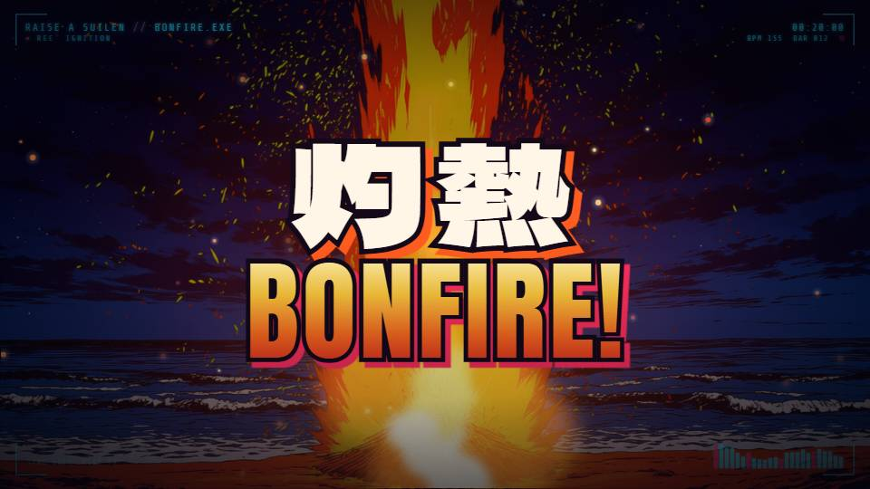
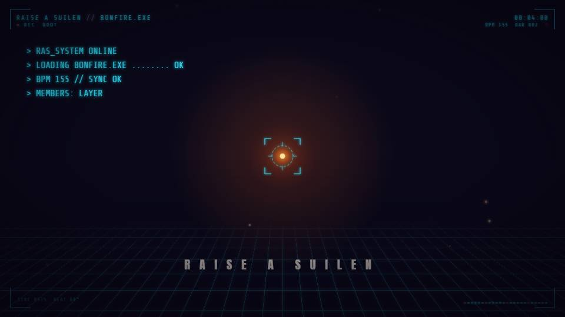
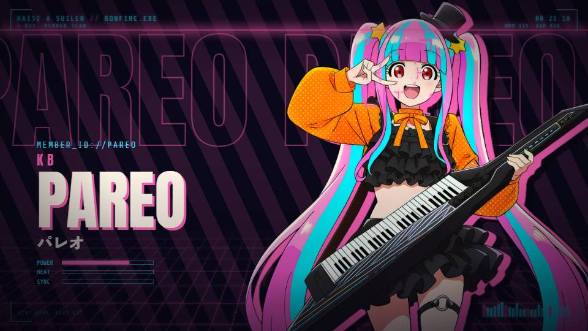
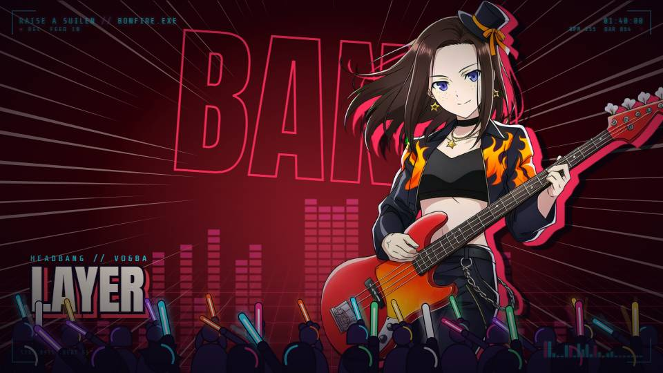
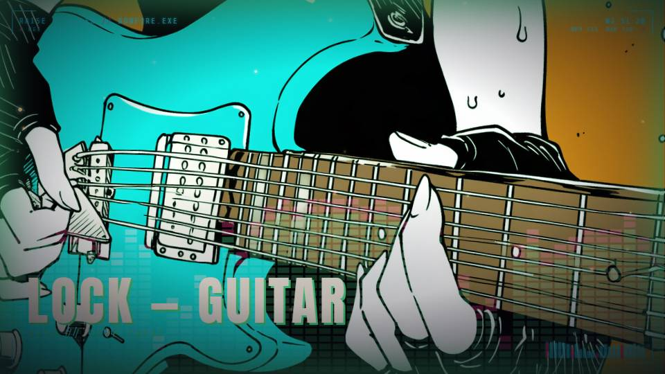

# 灼熱 Bonfire! — RAISE A SUILEN 非官方 MV（Remotion）

**繁體中文** ｜ [English](README.en.md) ｜ [日本語](README.ja.md)

用 [Remotion](https://www.remotion.dev/)（React）寫成的 RAISE A SUILEN〈灼熱 Bonfire!〉粉絲自製 MV。整支影片都是程式畫出來的：鏡頭、轉場、煙火、營火、歌詞排版、cyber 風介面都跟著實際音樂的拍點與人聲時間走；角色圖由 NovelAI 生成。

> ⚠️ 這是**非官方、非商業**的二次創作。本 repo **不含**歌曲音檔、官方歌詞與官方角色圖。使用前請先閱讀 [免責聲明](DISCLAIMER.md)。



| | |
| --- | --- |
|  |  |
|  |  |

## 影片與封面下載

[Google Drive：影片原始檔與封面](https://drive.google.com/drive/folders/1ye92bp0qG8TD5KNhDEJbyr9OYFZ7i0_q?usp=drive_link)

- **封面**：2:3 與 3:4 兩種比例。
- **影片**：4K60（3840 × 2160、60fps）與 1080p30（1920 × 1080、30fps）兩個版本。

可編輯的 Remotion 專案原始碼收錄於本 repo；影片與封面檔案由上述雲盤提供。

## 特色

- **跟著音樂走的時間軸**：用音訊分析量出 155 BPM、第一拍位置、重擊與人聲起音，鏡頭切在小節線上，歌詞在實際唱到時出現。
- **60fps 平滑動畫**：所有動畫以時間計算，60fps 輸出時每一格都是新畫面；可輸出 1080p30 或 4K60。
- **漫畫龐克 × RAS cyber 風**：漫畫描邊字、爆炸對話框、斜切轉場、切入（カットイン）、HUD、即時頻譜、故障效果、跟著大鼓揮應援棒的觀眾剪影。
- **程式繪製的特效**：canvas 漫畫風煙火（菊花、垂柳、環形、十字分裂、閃爍）、粒子營火、火星。
- **可重現的 AI 素材**：20 張圖的模型、完整提示詞、seed、尺寸與後製方式都記錄在 [docs/ASSETS.md](docs/ASSETS.md)。

## 專案結構

```
.
├── bonfire-mv/                 Remotion 專案
│   ├── src/mv/
│   │   ├── BonfireMV.tsx       全片時間軸（47 個鏡頭）
│   │   ├── scenes.tsx          各場景
│   │   ├── components/         歌詞層、煙火、cyber 介面、立繪、字型元件
│   │   ├── timing.ts           BPM 與小節換算 B()/S()
│   │   ├── cuts.ts             剪接點與轉場、重型段重擊
│   │   ├── lyrics.ts           歌詞時間、排版設定
│   │   └── data/
│   │       ├── audio.json          逐格頻譜與大鼓包絡（從原曲分析）
│   │       └── lyrics.sample.json  歌詞範本（文字以 ○ 代替）
│   ├── public/images/          NovelAI 生成的 20 張圖
│   └── scripts/analysis/       BPM、頻譜、人聲起音分析腳本
├── source/novelai/
│   ├── requests/ requests_v2/  每張圖送給 NovelAI 的完整請求
│   └── scripts/                生成腳本、綠幕去背腳本
├── tools/novelai/              NovelAI API 本機工具（PowerShell）
└── docs/                       分鏡、素材與提示詞、AI 工具說明
```

## 如何執行

需要 Node.js 20.19+ / 22.13+ / 24+，以及網路（字型從 Google Fonts 載入）。

1. **安裝套件**
   ```bash
   cd bonfire-mv
   npm install
   ```
2. **準備音檔**：自行合法取得〈灼熱 Bonfire!〉音檔，存成 `bonfire-mv/public/RAISE A SUILEN - 灼熱 Bonfire!.flac`（檔名需一致）。本 repo 的拍點與歌詞時間是依時長 3:44.80 的版本量測的，不同版本可能需要重新對時間。
3. **準備歌詞**：把 `src/mv/data/lyrics.sample.json` 複製成 `src/mv/data/lyrics.json`，再把裡面的 ○ 換成你自己取得的歌詞（`text`、`backing`、`layout.lines`、`hero[].text`）。
4. **預覽**
   ```bash
   npm run dev
   ```
5. **輸出**
   ```bash
   # 1080p 30fps
   npx remotion render BonfireMV out/bonfire_1080p30.mp4
   # 4K 60fps
   npx remotion render BonfireMV-60fps out/bonfire_4k60.mp4 --scale=2 --jpeg-quality=95
   ```

## 重新生成圖片

本 repo 已附上由 **OpenAI Codex 參與編寫**的本地 NovelAI plugin／API 接入工具，位於 [`tools/novelai/`](tools/novelai/)。它以 Windows PowerShell 5.1 執行，包含 Token 設定介面、訂閱查詢、單張文生圖／圖生圖、請求範例與離線測試；使用方式見 [工具說明](tools/novelai/README.md)。

圖片用 NovelAI Diffusion Anime V4.5 Full 生成，需要自己的 NovelAI 帳號與 Persistent API Token。

1. 依 [tools/novelai/README.md](tools/novelai/README.md) 設定 Token（以 Windows DPAPI 加密保存在本機，憑證檔已排除於 Git 追蹤之外）。
2. 修改 `source/novelai/scripts/nai2.py` 開頭的 `ROOT` 路徑後執行，例如：
   ```bash
   python source/novelai/scripts/nai2.py --style bold group_stage@1
   ```
3. 立繪是綠幕生成，用 `chroma.py` 去背：
   ```bash
   python source/novelai/scripts/chroma.py 原圖.png bonfire-mv/public/images/member_lock.png 預覽.jpg
   ```

每次生成都會消耗 NovelAI 的 Anlas（本專案 1MP 圖約 11–12 Anlas／張）。

## 使用的工具與模型

| 用途 | 工具 |
| --- | --- |
| 影片引擎 | Remotion 4.0.536、React 19、TypeScript |
| 角色與場景圖 | NovelAI Diffusion Anime V4.5 Full |
| 企劃、分鏡、程式、音訊分析、文件 | Claude（Anthropic），透過 Claude Code 協作 |
| 本地 NovelAI 接入工具的程式與文件協作 | OpenAI Codex |
| 音訊分析 | Python、NumPy、Remotion 內建的 FFmpeg |
| 去背 | Python、Pillow |
| 字型 | Dela Gothic One、Zen Kaku Gothic New、Anton、Share Tech Mono（皆為 SIL Open Font License） |

詳細的製作流程、分析方法與 AI 使用方式見 [docs/AI_TOOLS.md](docs/AI_TOOLS.md)，分鏡設計見 [docs/STORYBOARD.md](docs/STORYBOARD.md)。

## 授權

- **程式碼**（`bonfire-mv/src`、`scripts`、`tools`、`source/novelai/scripts`）：MIT License，見 [LICENSE](LICENSE)。
- **AI 生成圖片與提示詞**：僅供非商業的粉絲創作與學習參考。圖中角色的權利屬於原著作權人，本專案不對角色授予任何權利。
- **Remotion** 有自己的授權條款（個人與小型團隊免費），見 <https://www.remotion.dev/license>。
- **字型** 依各自的 SIL Open Font License。

## 致謝

- 原曲：RAISE A SUILEN〈灼熱 Bonfire!〉
- 《BanG Dream!》企劃
- 企劃與審片：Gokuraku
- 本地 NovelAI 接入工具與使用文件：OpenAI Codex 參與編寫
